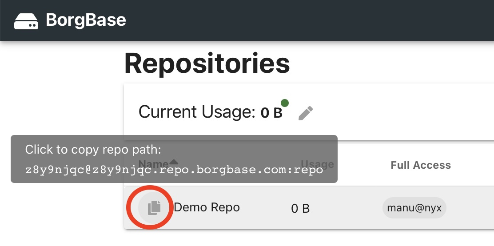

import { Tabs, TabItem } from '@astrojs/starlight/components';

_Reviewed in November 2026_

In this article we will set up a backup software called Borg Backup (or Borg for short). There are other backup solutions for Linux or macOS, but Borg has all the features we would expect from a proper backup, like encryption, compression and deduplication.

:::note
You should be comfortable using the command line. If you prefer a graphical client, look into our [Vorta Desktop Client](/setup/borg/vorta) instead.

Borg 2 is available as beta releases for testing, but there is no final release yet. It includes breaking repository and CLI changes. Where commands differ, you can choose the right version using the tabs above the code snippet. _BorgBase_ itself supports the latest release of every major branch and you can choose the preferred version for each repository.
:::

## Prerequisites

This tutorial assumes you are using a recent Linux, \*BSD or macOS machine. The instructions should work on macOS and popular Linux flavors, like Debian, Ubuntu, as well as Red Hat, Fedora and CentOS. You don't need to be a command line expert. All commands can be copy & pasted.

It also assumes that you have a server-based version of Borg available. The easiest option is to sign up for [BorgBase.com](https://www.borgbase.com), which offers a free tier of 10 GB. Other options are your own server with SSH access or one of the providers linked [here](https://www.borgbackup.org/support/commercial.html).

## Step 1 – Install Borg

In this step we will install Borg Backup. There are [many ways to install Borg](https://borgbackup.readthedocs.io/en/stable/installation.html). Here just the most common ones. For more details, look at the [Borg installation guide](https://borgbackup.readthedocs.io/en/stable/installation.html).

:::note
If you use Docker or a similar container tool, you can also use this [Borgmatic Docker image](https://github.com/borgmatic-collective/docker-borgmatic).
:::

<Tabs syncKey="install">

<TabItem label="Package manager">

Most distributions and Homebrew include Borg 1.x. The packaged version can lag behind the latest release.

```shell
$ sudo apt install borgbackup   # Debian, Ubuntu
$ sudo dnf install borgbackup   # Fedora, RHEL
$ brew install borgbackup       # macOS
```

</TabItem>

<TabItem label="Pre-compiled binary">

Download the latest release for your platform from the [Github page](https://github.com/borgbackup/borg/releases). This binary has everything you need in one file. Borg 2 betas are published on the same page as pre-releases.

The file name depends on your platform, e.g. `borg-macos-15-arm64-gh` or `borg-linux-glibc235-x86_64-gh`. Adjust the commands below accordingly.

First we move to the **Downloads** folder, where we downloaded Borg to.

```shell
$ cd ~/Downloads
```

Then give execute permissions to Borg.

```shell
$ chmod +x borg-macos-15-arm64-gh
```

Last, move it to a standard folder for applications. Depending on your setup you may need to enter your admin-password to write to this folder.

```shell
$ sudo mv borg-macos-15-arm64-gh /usr/local/bin/borg
```

</TabItem>

<TabItem label="Python package">

If you already keep some Python tools around, you can add Borg to a virtual environment. This compiles some parts of Borg, so the build dependencies listed in the [installation guide](https://borgbackup.readthedocs.io/en/stable/installation.html#pip-installation) are required.

```shell
$ python3 -m venv ~/borg-env
$ ~/borg-env/bin/pip install borgbackup
```

Recent Linux distributions and Homebrew no longer allow a plain `pip install` into the system Python.

</TabItem>

</Tabs>

That's it. You now have Borg installed on your local machine. You can test it by simply starting it and checking the version

```shell
$ borg --version
```

This should print something like `borg 1.4.5`.

## Step 2 – Create and Assign SSH Key for Authentication

In this step we will securely connect your machine to the remote repository using a SSH key. If you manage your own server or have already set SSH up, you can skip this step.

Let's start by generating a public-private key pair based on the (currently) most secure Ed25519 standard.

```shell
$ ssh-keygen -t ed25519
```

This will ask you for a location to save the key and a password. If you want to use automatic backups, you should enter an empty passphrase or add the passphrase to the macOS Keychain.

The private key should remain a secret on your local machine. The public key is passed to your remote/cloud backup repository. You can display the public key using this command:

```shell
$ cat ~/.ssh/id_ed25519.pub
```

Now just copy it and provide it to your repository provider. When using [BorgBase.com](https://www.borgbase.com), you can add public keys under **Account > SSH Keys**. For supported key types and more background, see [SSH Keys for BorgBase](/setup/borg/ssh-keys).

## Step 3 – Create a Remote Borg Repository

After adding your public key, you are ready to set up a remote repository. Different providers have different ways for this. When using BorgBase, add a new repository under **Repositories**. It will ask for a repo name, quota and which SSH key to use. You can also choose between US and EU server locations. All options are described under [Repository Settings](/repositories/settings).

After adding the repo, you can copy the repository location using the icon in the first **Name** column.



This will tell Borg where to connect to for storing backups and it will use your public SSH key to authenticate itself. There are no passwords to remember and it's very difficult to crack a key due to its length.

:::note
You may still see the older SCP-style format (`xxx@xxx.repo.borgbase.com:repo`) in some places. It is deprecated in Borg 1.x and no longer accepted by Borg 2. The _BorgBase_ control panel will give you the `ssh://` format by default.
:::

## Step 4 – Initialize Repository and Run a First Backup

Now that we have a secure connection to our repository, we can start using it. The first step is to **initialize** it. This involves setting an encryption mode and password.

Borg can keep the encryption key in two places. `repokey` means that the key is protected by a password and stored in the remote backup repo. There is also `keyfile`, which stores the key in your home-folder. It's important to know that _both_ the key and the password are required to access a repo. So if you lose your laptop with the keyfile on it, you can't access the backup. That's why it's important to either use repokey or keep a copy of the keyfile somewhere else.

To initialize the remote repo, use the commands below. Replace the `ssh://` URL with your actual full repository address given in the control panel. The repository URL will be kept as `BORG_REPO` variable to avoid typing it each time.

<Tabs syncKey="borg">

<TabItem label="Borg 1.x">

```shell
$ export BORG_REPO=ssh://xxx@xxx.repo.borgbase.com/./repo
$ borg init -e repokey-blake2
```

</TabItem>

<TabItem label="Borg 2.x">

```shell
$ export BORG_REPO=ssh://xxx@xxx.repo.borgbase.com/./repo
$ borg benchmark cpu  # optional: find fastest encryption algorithm
$ borg repo-create --encryption=chacha20-poly1305
```

Borg 2 selects the cipher (`aes256-ocb` or `chacha20-poly1305`), the ID hash (`--id-hash`, `sha256` by default or `blake3`) and the key location (`--key-location`, `repokey` by default) independently. Encryption speed can vary depending on CPU and if a virtual machine is used. So it's best to benchmark it and choose the fastest combination. More [here](https://borgbackup.readthedocs.io/en/master/usage/repo-create.html).

</TabItem>

</Tabs>

Initializing the repository will ask you for a passphrase to protect the repository key. Make it nice and long and keep it somewhere safe.

After the command is done, you have your remote backup repository set up and ready to accept files. You can add some test files from your _Documents_ folder with this command:

<Tabs syncKey="borg">

<TabItem label="Borg 1.x">

```shell
$ borg create ::my-archive-1 ~/Documents
```

`my-archive-1` is the archive name. It needs to be unique, so mostly people use the hostname and a timestamp. E.g. `tim-macbook-2018-10-10`.

</TabItem>

<TabItem label="Borg 2.x">

```shell
$ borg create documents ~/Documents
```

`documents` is the archive name. In Borg 2 it identifies a _series_ of archives. Use the same name for each run of the same backup and don't add a timestamp. Borg records the time and hostname itself.

</TabItem>

</Tabs>

Archives allow you to access different versions of your files. This can be useful if a file was deleted by accident or encrypted by a cryptolocker.

## Step 5 – Set up Borgmatic for Regular Backups

After completing the previous steps, you are ready to use Borg for simple operations. It would be quite cumbersome to manually run Borg every few hours and keep track of excluded files and old archives. That's why we will use a helper tool – [Borgmatic](https://torsion.org/borgmatic/) – to do this job for us.

### Install Borgmatic

Borgmatic is written in Python and there is no pre-compiled binary. The recommended way to install it is [uv](https://docs.astral.sh/uv/getting-started/installation/), which keeps it separate from other Python packages on your system. For system-wide backups, install it as root:

```shell
$ sudo uv tool update-shell
$ sudo uv tool install borgmatic
```

If you plan on only backing up your home folder, installing it as your own user will work too:

```shell
$ uv tool update-shell
$ uv tool install borgmatic
```

Many distributions also offer a `borgmatic` package, though it can be considerably older. See the [Borgmatic installation guide](https://torsion.org/borgmatic/how-to/install-borgmatic/) for all options.

### Add a Configuration File

Let's start by creating a default Borgmatic folder:

```shell
$ mkdir -p ~/.config/borgmatic
```

Then open the main config file with your favorite text editor. I'll use `nano`, but any other editor will work too.

```shell
$ nano ~/.config/borgmatic/config.yaml
```

If you keep your repos with BorgBase you can copy a pre-made Borgmatic configuration from the **Setup** page. Or start with this version and fill in the blanks:

<Tabs syncKey="borgmatic_config">

<TabItem label="Borgmatic 1.8 and newer">

```yaml
# ~/.config/borgmatic/config.yaml
source_directories:
  - ~/Desktop
  - ~/Documents
  - ~/Pictures

# one_file_system: true

repositories:
  - path: ssh://mmvz9gp4@mmvz9gp4.repo.borgbase.com/./repo

exclude_caches: true

compression: auto,zstd
encryption_passphrase: CHANGE ME!!

# Number of times to retry a failing backup
retries: 5
retry_wait: 5

keep_daily: 3
keep_weekly: 4
keep_monthly: 12

# Don't read whole repo each time
checks:
  - name: repository
    frequency: 4 weeks
```

</TabItem>

<TabItem label="Borgmatic 1.7 and older (legacy)">

```yaml
# ~/.config/borgmatic/config.yaml
location:
  source_directories:
    - ~/Desktop
    - ~/Documents
    - ~/Pictures

  # one_file_system: true

  repositories:
    - ssh://mmvz9gp4@mmvz9gp4.repo.borgbase.com/./repo

  exclude_caches: true

storage:
  compression: auto,zstd
  encryption_passphrase: CHANGE ME!!
  archive_name_format: "{hostname}-{now}"

  # Number of times to retry a failing backup
  retries: 5
  retry_wait: 5

retention:
  keep_daily: 3
  keep_weekly: 4
  keep_monthly: 12

consistency:
  checks:
    - disabled
    # Uncomment to regularly read all repo data
    # - name: repository
    #   frequency: 4 weeks
    # - name: archives
    #   frequency: 8 weeks

  check_last: 3
```

</TabItem>

</Tabs>

:::note
The configuration format for Borgmatic changed in version 1.8. Make sure to use the appropriate configuration block based on your Borgmatic version (`borgmatic --version`). The older section-based format still works in Borgmatic 2.x, but emits deprecation warnings. You can learn more about the changes in the [changelog](https://github.com/borgmatic-collective/borgmatic/releases/tag/1.8.0).
:::

Let's look at the major options of this file one-by-one. Since the format is YAML, white-space, like spaces is important.

- `source_directories`: The list of folders you actually want to back up. You can always add more source folders later. They will simply be added.
- `repositories`: The address of your backup repo.
- `encryption_passphrase`: The password to access the repo, as set in step 4.
- `keep_*`: Determines how many snapshots Borg will keep.
- `checks`: How often Borgmatic verifies the repository. Reading all repo data takes time, so this is limited to once every four weeks. Please don't check more often than this. See [here](/troubleshooting/performance#how-often-should-i-run-borg-check) for why.

Archive names are chosen by Borgmatic. By default it uses the hostname and a timestamp with Borg 1 and just the hostname (as series name) with Borg 2. Set `archive_name_format` to change this.

Once you are happy with the options, save the file and check it for errors:

```shell
$ borgmatic config validate
```

### Run the First Backup

If you already initialized the repository in step 4, skip the next command. Otherwise you can also initialize it via Borgmatic, like you would with Borg only:

<Tabs syncKey="borg">

<TabItem label="Borg 1.x">

```shell
$ borgmatic repo-create --encryption repokey-blake2
```

</TabItem>

<TabItem label="Borg 2.x">

```shell
$ borgmatic repo-create --encryption chacha20-poly1305
```

</TabItem>

</Tabs>

Run `borgmatic create` to create a new backup. We will add the `--verbosity` option to see what's going on during the first backup.

```shell
$ borgmatic --verbosity 2 create
```

Depending on your backup folder size, this may take a while. After Borgmatic is done, you can view the available snapshots and some statistics.

```shell
$ borgmatic repo-list repo-info
```

After a few seconds you should get some output similar to this (shown for Borg 1.x, the output of Borg 2 is structured differently):

```
nyx2.local-2018-10-06T11:17:51       Sat, 2018-10-06 11:17:58 [6fa5db68d...aef3ea]
nyx2.local-2018-10-09T12:31:35       Tue, 2018-10-09 12:31:43 [6fa5db68d...aef3ea]
Repository ID: a59c22b17eeb4e9798...987d2f26873c
Location: ssh://mmvz9gp4@mmvz9gp4.repo.borgbase.com/./repo
Encrypted: Yes (repokey)
Cache: /Users/manu/.cache/borg/a59c22b17eeb...d2f26873c
Security dir: /Users/manu/.config/borg/security/a59c22b17e...2f26873c
------------------------------------------------------------------------------
                       Original size      Compressed size    Deduplicated size
All archives:              134.41 GB             92.98 GB              7.17 GB

                       Unique chunks         Total chunks
Chunk index:                   25309               349526
```

You can see that there are 2 snapshots in this repository with a total of 134 GB of data. After compression the files were 92 GB and after deduplication only 7 GB. The reason for this difference is that every snapshot includes the same data, so there is a lot of potential for deduplication.

## Step 6 – Put your Backups on Auto-Pilot

With Borgmatic working, we can set up Cron to do regular backups in the future. Cron is an old Unix tool to run _repeated_ tasks. It's usually included in all Unix-like systems.

```shell
$ crontab -e
```

This will open an editor to add new cron jobs. There are many ways to schedule cron-jobs. For hourly backups enter this:

```
@hourly borgmatic
```

This will run `borgmatic` every hour. Without further arguments, it creates a new backup, prunes old archives, compacts the repository and runs any checks that are due. You could also schedule it every 3 hours, always 10 minutes after the full hour:

```
10 */3 * * * borgmatic
```

Cron uses a minimal `PATH`. If the job doesn't find `borgmatic`, use the full path instead, as printed by `which borgmatic`.

On Linux systems using systemd, you can use a timer instead of Cron. Borgmatic provides sample unit files for this [here](https://torsion.org/borgmatic/how-to/set-up-backups/#autopilot).

When you're done, save the file and you should be set. You can always make sure backups actually happen using the `borgmatic repo-list` command or by setting a monitoring alert on BorgBase.com. It will alert you if no new snapshots are added for a set amount of time.

## Conclusion

You now have a reliable and secure backup setup. Borg and Borgmatic offer many other options. As next steps you can:

- [Export](https://borgbackup.readthedocs.io/en/stable/usage/key.html#borg-key-export) your repokey to keep it secure somewhere. It's also possible to [print](https://borgbackup.readthedocs.io/en/stable/paperkey.html) it.
- Learn more about available compression options to see what works well with your data. `$ borg help compression`
- View all available Borgmatic [options](https://torsion.org/borgmatic/reference/configuration/), like excluding certain files.
- Set up a local backup repository to backup to a hard drive or thumb drive. This is not a replacement for a cloud backup, but does provide some protection against failed hardware if the size of the data is too large to upload.
- [Verify](/verify) that your backups work and try a [test restore](/restore/borg).
